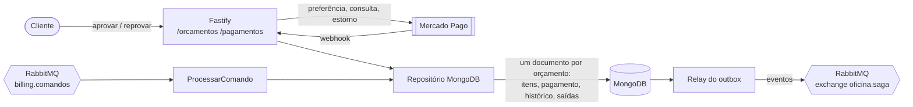

# Oficina Mecânica — Orçamento e Pagamento

Microsserviço de **orçamentos e pagamentos**: gera o orçamento a partir do diagnóstico, colhe a aprovação do cliente, cobra pelo **Mercado Pago** e estorna quando a saga precisa desfazer. Participa da saga orquestrada pelo [OS Service](https://github.com/Xikin/tech_challenge). Tech Challenge — Fase 4.

| Repositório | Papel |
| --- | --- |
| [oficina-mvp](https://github.com/Xikin/tech_challenge) | OS Service — orquestrador da saga; diagrama geral e ADRs da Fase 4 |
| [oficina-execucao](https://github.com/Xikin/oficina-execucao) | Execução e Produção |
| **oficina-billing** (este) | Orçamento e Pagamento |
| [oficina-auth-lambda](https://github.com/Xikin/oficina-auth-lambda) · [oficina-infra-k8s](https://github.com/Xikin/oficina-infra-k8s) · [oficina-infra-db](https://github.com/Xikin/oficina-infra-db) | Autenticação e infraestrutura |

## Responsabilidades

- **Gerar e enviar orçamentos para aprovação**: recebe os itens do diagnóstico, congela nome, quantidade e preço e avisa a saga. O e-mail ao cliente sai do OS Service, que é o dono do cadastro.
- **Aprovação**: o cliente (token emitido pela Lambda) ou a oficina aprova ou reprova. Aprovar cria a cobrança no Mercado Pago e devolve o link.
- **Registrar e verificar pagamentos**: o webhook do Mercado Pago é validado e o status é sempre conferido na API do Mercado Pago antes de valer.
- **Atualizar a OS após o pagamento**: publica `billing.evento.pagamento-confirmado`; o OS Service muda a OS e libera o reparo.
- **Estornar**: na compensação da saga e, automaticamente, em qualquer pagamento que não quita o orçamento (tardio, em dobro ou de valor menor).

## Arquitetura



```
AGUARDANDO_APROVACAO → APROVADO → PAGO → (compensação) ESTORNADO
                     ↘ REPROVADO   ↘ PAGAMENTO_RECUSADO
              (compensação antes do pagamento) → CANCELADO
```

## Por que MongoDB

O orçamento é uma **foto**: itens e preços do momento em que foi gerado, que não podem mudar se o catálogo mudar. A resposta do Mercado Pago muda de formato conforme o meio de pagamento. As consultas são sempre por chave (`_id`, `ordemId`).

O motivo decisivo é a atomicidade. Estado, pagamento, histórico e **outbox** (array `saidas`) moram no mesmo documento, e a atualização de um documento é atômica no MongoDB. Com isso o outbox funciona sem transação multi-documento e sem replica set. A idempotência vem do próprio dado: índice único por `ordemId` e transições condicionadas a `status` e `versao`. Ver [ADR-0016](https://github.com/Xikin/tech_challenge/blob/main/docs/adr/0016-persistencia-poliglota.md).

## Mercado Pago

[ADR-0017](https://github.com/Xikin/tech_challenge/blob/main/docs/adr/0017-mercado-pago-checkout-pro.md).

| Etapa | Chamada |
| --- | --- |
| Aprovação | `POST /checkout/preferences` com `external_reference` = id do orçamento e `notification_url` = `<gateway>/pagamentos/webhook` |
| Notificação | `POST /pagamentos/webhook` → valida `x-signature` (HMAC-SHA256) → `GET /v1/payments/{id}` |
| Estorno | `POST /v1/payments/{id}/refunds` com `X-Idempotency-Key` |

**Modo simulado** (padrão quando não há token): a cobrança devolve um link local, e `POST /pagamentos/simulador/{orcamentoId}` com `{"aprovado": true}` tem o mesmo efeito do webhook. O pipeline liga o modo real sozinho quando o secret `MERCADO_PAGO_ACCESS_TOKEN` existe. Com token de teste (`TEST-...`), o link é o do sandbox.

Para usar o Mercado Pago de verdade:

1. Crie uma aplicação no [painel de desenvolvedores](https://www.mercadopago.com.br/developers/panel/app).
2. Cadastre o *Access Token* de teste como `MERCADO_PAGO_ACCESS_TOKEN`.
3. Em **Webhooks**, cadastre `<API_GATEWAY_URL>/pagamentos/webhook` para o evento *Pagamentos* e grave a assinatura secreta como `MERCADO_PAGO_WEBHOOK_SECRET`.

## Na saga

| Recebe | Faz | Responde |
| --- | --- | --- |
| `billing.comando.gerar-orcamento` | Cria o orçamento | `billing.evento.orcamento-gerado` (ou `orcamento-falhou` sem itens) |
| `billing.comando.cancelar` | Estorna se pago; senão cancela; se já encerrado, só reconfirma | `billing.evento.cancelado` com `estornado` |

| Ação | Publica |
| --- | --- |
| `POST /orcamentos/:id/aprovar` | `billing.evento.orcamento-aprovado` com o link |
| `POST /orcamentos/:id/reprovar` | `billing.evento.orcamento-reprovado` → a saga compensa |
| Pagamento aprovado | `billing.evento.pagamento-confirmado` |
| Pagamento recusado ou com valor menor | `billing.evento.pagamento-recusado` |

Contrato completo: [docs/saga.md do OS Service](https://github.com/Xikin/tech_challenge/blob/main/docs/saga.md).

## API

- **Swagger:** `/docs` no serviço; pelo API Gateway as rotas são `/orcamentos` e `/pagamentos`
- **OpenAPI:** [`docs/openapi.json`](docs/openapi.json) · **Postman:** [`postman/`](postman/)
- O cliente só vê e decide os próprios orçamentos; a listagem é só da oficina; o webhook é público e protegido pela assinatura.

## Executar

Pelo `docker-compose.yml` do OS Service (ver o [README de lá](https://github.com/Xikin/tech_challenge#executar-localmente)). Sozinho, com um MongoDB local:

```bash
npm ci
cp .env.example .env
npm run dev
```

## Testes e qualidade

| Tipo | Comando | Resultado |
| --- | --- | --- |
| Unitários e de integração (Vitest) | `npm test` | 83 testes |
| Qualidade (SonarQube Cloud) | pipeline | quality gate bloqueia a imagem |

**Cobertura:**

| Camada | Linhas |
| --- | --- |
| domain | 95,4% |
| application | 100% |
| infrastructure | 97,8% |
| presentation | 96,4% |
| **total** | **96,9%** linhas · 91,9% branches · 94,3% funções |

O pipeline exige no mínimo 80%. O relatório HTML fica no artefato `coverage` de cada execução.

## CI/CD e Kubernetes

`.github/workflows/ci-cd.yml`:

- **PR:** formatação, typecheck, build, testes com cobertura e Sonar com quality gate.
- **Push:** tudo isso, mais a imagem no ECR (`/oficina/<env>/ecr/billing_repository_url`) e o deploy no EKS:
  1. sobe o MongoDB (StatefulSet com volume EBS, senha gerada no SSM na primeira vez), a menos que o secret `MONGODB_URI` aponte para um Atlas;
  2. aplica `k8s/`;
  3. publica `/oficina/<env>/billing/endpoint`;
  4. roda o smoke test.

Depende de, no SSM: `eks/cluster_name`, `mensageria/rabbitmq_url`, `auth/jwt_secret`, `auth/jwt_cliente_secret` e, para o webhook, `gateway/url`, publicado pelo repositório da Lambda. Secrets do repositório: credenciais do Learner Lab, `SONAR_TOKEN`, chaves do New Relic e, opcionalmente, `MERCADO_PAGO_ACCESS_TOKEN`, `MERCADO_PAGO_WEBHOOK_SECRET` e `MONGODB_URI`.

Decisões de código e configuração, por arquivo: [docs/notas-de-implementacao.md](docs/notas-de-implementacao.md).
